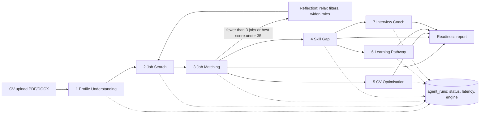

# Agent workflow

Match score = 0.35 semantic similarity + 0.50 weighted skill coverage + 0.15 experience fit.
Bands: 80+ Highly qualified, 60+ Qualified with gaps, otherwise Development required.

Text-producing steps call `try_llm()`. With the mock provider (default) they return rule-based templates and are
labelled `template`; a failing real model falls back to `template-fallback`. Contact details are redacted before any
text leaves the server.
